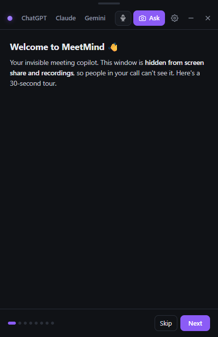

<div align="center">

# MeetMind

### Your AI workspace, within reach during a meeting.

A compact desktop overlay for **ChatGPT · Claude · Gemini**, with screenshot prompts, local speech transcription, and a capture-protected mode on supported systems.

[](LICENSE)
[](https://www.electronjs.org/)
[](package.json)

[Quick start](#quick-start) · [Visible vs. protected](#visible-vs-protected-mode) · [Screenshots](#screenshots) · [Hotkeys](#hotkeys) · [Feature ideas](docs/ROADMAP.md)

</div>

---

## What it does

- **Bring your own AI account.** Switch between ChatGPT, Claude and Gemini. Provider logins persist between launches; no separate API key is required.
- **Ask about your screen.** A hotkey captures the display under your cursor and pastes it into the active AI with your chosen prompt. Automatic sending is optional.
- **Listen, then ask.** Record a segment, transcribe it locally with Whisper, and send the text to your AI. Windows loopback audio can capture the call, with an optional microphone.
- **Add useful context.** Choose Short, Detailed, image-only, or a custom prompt with a local Markdown/text context file.
- **Keep the interface compact.** Always-on-top window, adjustable opacity, collapse-to-toolbar, hide-to-tray and a first-run tour.
- **Choose how it appears in captures.** Capture protection is enabled by default; visible mode is available for demos and debugging.

> Capture protection is a best-effort OS feature, not a guarantee of invisibility in every recorder. Check your exact OS and sharing application before relying on it. [Platform limitations ↓](#capture-protection-limitations)

## Visible vs. protected mode


*Illustration of the intended behavior, not a screenshot or certification of a particular recording app.*

| Mode | What you see | What a compatible capture sees | Use it for |
|---|---|---|---|
| **Protected — default** | MeetMind stays on your desktop | OS requests exclusion of the window; behavior depends on platform/capture method | Your normal overlay setup, after checking capture compatibility |
| **Visible — demo mode** | The same MeetMind interface | MeetMind can appear in screenshots and recordings | README screenshots, demos, debugging and UI testing |
| **Hidden to tray** | Window disappears until shown again | No displayed overlay window | Temporarily getting the window out of your way |

**“Protected” does not mean hidden from you.** The show/hide hotkey is a separate action. Visible mode changes capture protection; it does not turn the overlay into a conventional taskbar window.

### Windows PowerShell

Stop the current app first (tray menu → **Quit**), then choose one:

**Visible / capturable**

```powershell
$env:MEETMIND_VISIBLE='1'; npm run dev
```

**Protected / default**

```powershell
Remove-Item Env:\MEETMIND_VISIBLE -ErrorAction SilentlyContinue
npm run dev
```

To switch modes, quit and relaunch. Environment variables remain set for the current terminal session. **Do not use `MEETMIND_VISIBLE='0'` to restore protection:** the current code checks whether the value is non-empty, so `'0'` also disables protection. Clear the variable instead.

### macOS / Linux shell

```bash
# Visible / capturable
MEETMIND_VISIBLE=1 npm run dev

# Request default capture protection
env -u MEETMIND_VISIBLE npm run dev
```

Setting the default does not add capture protection on an unsupported platform. See the limitations below.

## Screenshots

Real app screenshots from a separate, signed-out demo profile. No meeting, personal chat, audio recording or AI message was used.

<table>
  <tr>
    <th>First-run tour</th>
    <th>Prompts &amp; audio settings</th>
  </tr>
  <tr>
    <td></td>
    <td></td>
  </tr>
</table>

Both screenshots were captured in **visible mode**. They show the UI, not proof that screen-share exclusion works. The current tour's blanket invisibility wording should be read with the platform caveats in this README. [Capture notes](docs/images/README.md)

## Quick start

Requires **Node.js 20+** and npm. Provider sign-in and account limits still apply.

```bash
git clone https://github.com/smsolutionsva-byte/MeetMind.git
cd MeetMind
npm ci
npm run dev
```

For a demo or screenshot session on Windows, use the visible-mode command above.

| Command | Purpose |
|---|---|
| `npm run dev` | Start the development app |
| `npm run typecheck` | Check TypeScript |
| `npm run build` | Build the app into `out/` |
| `npm start` | Run the built app |

No installer is included yet. The first speech-model use requires a download; model sizes shown in Settings are approximate.

## Hotkeys

| Keys | Action |
|---|---|
| `Ctrl+Shift+Space` | Screenshot and ask the active AI |
| `Ctrl+Shift+L` | Start listening; press again to stop, transcribe and ask |
| `Ctrl+Shift+H` | Show / hide the window |
| `Ctrl+Shift+1` | Switch to ChatGPT |
| `Ctrl+Shift+2` | Switch to Claude |
| `Ctrl+Shift+3` | Switch to Gemini |

The app registers Command-or-Control shortcuts, so **Command** replaces Ctrl on macOS. The tray's purple-dot menu can show, hide and quit the app. If a shortcut is already registered by another app or another MeetMind instance, it may be unavailable; check the terminal output.

## Capture-protection limitations

MeetMind requests protection through Electron's `BrowserWindow.setContentProtection(true)`.

- **Windows 10 version 2004+ / Windows 11:** requests `WDA_EXCLUDEFROMCAPTURE`. Supporting capture paths can omit the window.
- **Older Windows:** may capture a black rectangle instead of excluding the window.
- **macOS:** newer capture applications using **ScreenCaptureKit may capture the window despite protection**.
- **Linux:** no equivalent capture exclusion is provided by this implementation.
- **Visible mode:** intentionally skips the protection request for app-created windows.

No Zoom/Meet/Teams/OBS compatibility matrix has been verified for this documentation update. Check the receiving device or recording output in your own setup; seeing an overlay on your desktop alone tells you nothing about the captured result.

Source: [Electron content-protection documentation](https://www.electronjs.org/docs/latest/api/browser-window#winsetcontentprotectionenable-macos-windows).

## Privacy & data flow

```text
Screenshot + prompt/context ────────────► selected AI website
Meeting audio ──► local Whisper ──► transcript + prompt ──► selected AI website
```

Speech recognition runs locally; AI replies still come from the provider you use. Model downloads, provider pages, account sign-in and provider-side processing require network access. “Local transcription” is not a claim that the entire app is offline.

Provider cookies/logins and local settings persist in MeetMind's app-data directory. Avoid including confidential content in screenshots or context files without permission. Turning off **Send automatically after pasting** lets you review the draft in the provider before sending.

### Separate demo profile

Keep screenshots and UI experiments away from your saved provider sessions:

```powershell
$env:MEETMIND_USER_DATA=Join-Path $env:TEMP 'meetmind-demo'
$env:MEETMIND_VISIBLE='1'
npm run dev
```

Quit the demo before returning to your normal profile:

```powershell
Remove-Item Env:\MEETMIND_USER_DATA -ErrorAction SilentlyContinue
Remove-Item Env:\MEETMIND_VISIBLE -ErrorAction SilentlyContinue
npm run dev
```

Clearing those environment variables does not delete the demo's files.

| Variable | Effect |
|---|---|
| `MEETMIND_VISIBLE=1` | Leave app windows capturable; clear the variable for default protection |
| `MEETMIND_USER_DATA=<folder>` | Separate settings, provider sessions and model cache |
| `MEETMIND_DRY_RUN=1` | Listen mode logs the transcript instead of sending it to the AI; avoid sensitive audio in test logs |

## How it works

- **AI tabs:** providers run in Electron `WebContentsView` instances using the persistent `persist:meetmind` session.
- **Screenshot flow:** captures the display under your cursor at native resolution, uses clipboard paste and optionally sends after the upload completes. Existing clipboard text is restored afterward.
- **Listen flow:** Windows system audio uses loopback capture; microphone input is optional. Audio is resampled to 16 kHz and transcribed in a Whisper worker thread via Transformers.js.
- **Provider integration:** uses the providers' web interfaces, so account restrictions and site changes can affect login, paste or Send. A Chrome-style user agent is used; successful third-party sign-in is not guaranteed.
- **Speech models:** the selected model is cached under the app-data directory after download.

## Roadmap & feature ideas

Implemented: screenshot-to-AI, provider tabs, prompt presets/context, local listen/transcribe flow, onboarding and compact overlay controls.

Suggested next improvements:

1. **Mode badge & capture diagnostics** — make Visible/Protected intent obvious and show platform caveats.
2. **Area capture with preview/redaction** — choose what leaves the device before sending.
3. **Configurable hotkeys & conflict feedback** — detect unavailable shortcuts and offer alternatives.
4. **Push-to-talk & cancelable transcription** — predictable recording and recovery from long/failed jobs.
5. **Opt-in transcript history/export** — local Markdown notes, clear retention and one-click clearing.
6. **Installers & CI checks** — signed releases where feasible, type/build checks and platform smoke tests.

Later ideas: live transcript/question detection, optional API/Ollama mode, and explicit confirmation before typing an answer into another app. These are **proposals**, not shipped features. [Prioritized ideas and acceptance criteria](docs/ROADMAP.md)

## People & AI acknowledgements

**Maintainer:** [Shivansh Mukhia · @smsolutionsva-byte](https://github.com/smsolutionsva-byte)

| AI tool | Acknowledgement |
|---|---|
| **Claude** | Initial implementation assistance, as recorded in the initial commit's co-author attribution |
| **Codex** | README refresh, visibility-mode guide, demo screenshots and feature-planning documentation |
| **GitHub Copilot** | Additional AI tool acknowledged at the maintainer's request; no specific code contribution verified here |
| **Gemini** | Additional AI tool acknowledged at the maintainer's request; also an available in-app AI provider |

This section credits people/tools without claiming they all authored code. GitHub's **Contributors** graph is generated from attributable commits; listing a tool here does not create a contributor account or verified commit attribution.

## Contributing

Bug reports are especially useful when they include OS/version, app revision, Visible/Protected mode, provider and reproducible steps. Use a clean demo profile and remove personal content from attachments. For capture reports, say which sharing/recording application and capture method you tested.

Start with `npm run typecheck` and `npm run build`. Keep changes focused, and document platform limitations rather than promising universal behavior.

## Notes & credits

Use MeetMind in meetings where you have permission to use AI and capture/transcribe the relevant content. It is not intended to bypass exam proctoring or lockdown browsers. Treat generated answers as suggestions to check.

Ideas for some tricky parts came from [free-cluely](https://github.com/Prat011/free-cluely) and [OpenCluely](https://github.com/TechyCSR/OpenCluely). The initial project credits these as inspiration and states that no code was copied.

## License

[MIT](LICENSE)
