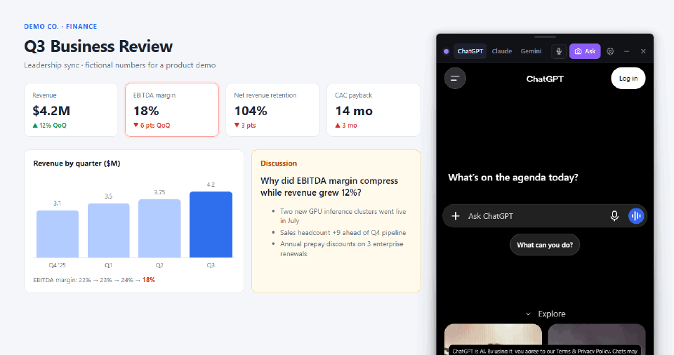
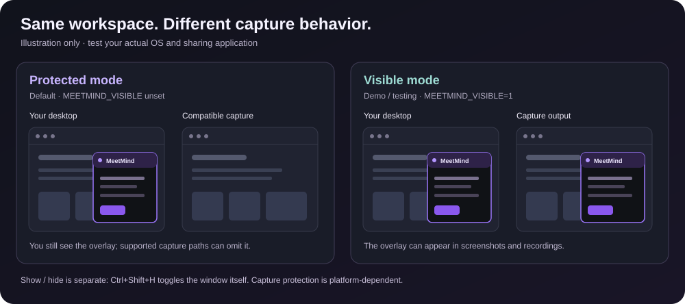
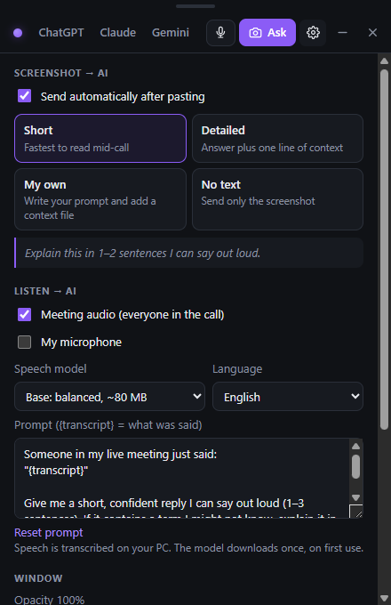
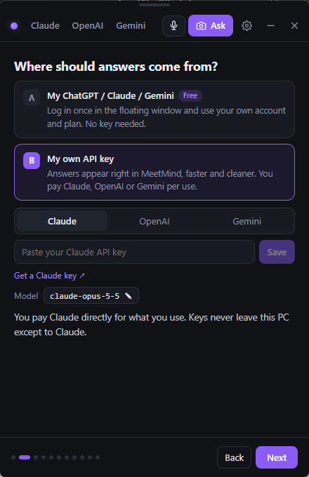
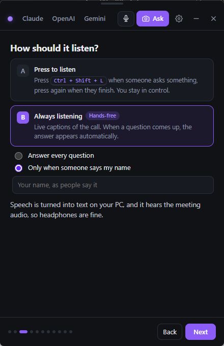
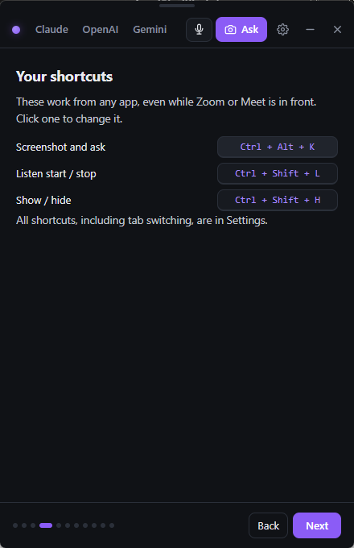

<div align="center">

# MeetMind

### Your AI workspace, within reach during a meeting.

A compact desktop overlay for **ChatGPT · Claude · Gemini**, with screenshot prompts, local speech transcription, and a capture-protected mode on supported systems.

[](LICENSE)
[](https://www.electronjs.org/)
[](package.json)
[](https://ko-fi.com/shivanshmukhia)

**Free and open source, forever.** If MeetMind saved you in a meeting, [buy me a chai on Ko-fi ☕](https://ko-fi.com/shivanshmukhia)



<sub>Real recording, one hotkey press: MeetMind screenshots the slide and ChatGPT (guest mode, no login) explains it. The slide and company are fictional; visible mode was on so the window shows up in the recording.</sub>

[Install](#install-windows) · [Visible vs. protected](#visible-vs-protected-mode) · [Screenshots](#screenshots) · [Hotkeys](#hotkeys) · [Feature ideas](docs/ROADMAP.md)

</div>

---

## What it does

- **Bring your own AI account — or your own API key.** Use your logged-in ChatGPT, Claude or Gemini in the floating window (no key required), or paste a Claude, OpenAI or Gemini API key and get answers streamed straight into MeetMind. Keys are encrypted with the OS keychain and stay on your PC.
- **Ask about your screen.** A hotkey captures the display under your cursor, or an area you drag out (Settings → Screenshot area), and pastes it into the active AI with your chosen prompt. Automatic sending is optional.
- **Listen: press-to-talk or always on.** Record a segment and ask, or turn on **always listening**: live captions of the call, with questions (or only questions after your name) answered automatically. Speech is transcribed locally with Whisper; Windows loopback audio captures the call, with an optional microphone.
- **Meeting notes, kept on your PC.** What MeetMind hears is saved as a transcript per meeting (on by default, one switch to turn off). The **Meeting notes** window lists past meetings with search, one-click summaries (key points, decisions, action items, jargon explained) and an ask box for one meeting or all of them, like "what did the CFO say about margins?".
- **Add useful context.** Choose Short, Detailed, image-only, or a custom prompt with a local Markdown/text context file.
- **Your shortcuts, your setup.** A first-run setup asks the important A/B questions (AI accounts vs. API key, press-to-talk vs. always listening), then tours every button. All shortcuts are customizable, with conflict warnings.
- **Keep the interface compact.** Always-on-top window, adjustable opacity, collapse-to-toolbar, hide-to-tray and a drag grip.
- **Choose how it appears in captures.** Capture protection is enabled by default; visible mode is available for demos and debugging.

> Capture protection is a best-effort OS feature, not a guarantee of invisibility in every recorder. Check your exact OS and sharing application before relying on it. [Platform limitations ↓](#capture-protection-limitations)

## Visible vs. protected mode



*Illustration of the intended behavior, not a screenshot or certification of a particular recording app.*

| Mode | What you see | What a compatible capture sees | Use it for |
|---|---|---|---|
| **Protected — default** | MeetMind stays on your desktop | OS requests exclusion of the window; behavior depends on platform/capture method | Your normal overlay setup, after checking capture compatibility |
| **Visible — demo mode** | The same MeetMind interface | MeetMind can appear in screenshots and recordings | README screenshots, demos, debugging and UI testing |
| **Hidden to tray** | Window disappears until shown again | No displayed overlay window | Temporarily getting the window out of your way |

**“Protected” does not mean hidden from you.** The show/hide hotkey is a separate action. Visible mode changes capture protection; it does not turn the overlay into a conventional taskbar window.

### Windows PowerShell

Stop the current app first (tray menu → **Quit**), then choose one:

**Visible / capturable**

```powershell
$env:MEETMIND_VISIBLE='1'; npm run dev
```

**Protected / default**

```powershell
Remove-Item Env:\MEETMIND_VISIBLE -ErrorAction SilentlyContinue
npm run dev
```

To switch modes, quit and relaunch. Environment variables remain set for the current terminal session. **Do not use `MEETMIND_VISIBLE='0'` to restore protection:** the current code checks whether the value is non-empty, so `'0'` also disables protection. Clear the variable instead.

### macOS / Linux shell

```bash
# Visible / capturable
MEETMIND_VISIBLE=1 npm run dev

# Request default capture protection
env -u MEETMIND_VISIBLE npm run dev
```

Setting the default does not add capture protection on an unsupported platform. See the limitations below.

## Screenshots

Real app screenshots from a separate, signed-out demo profile. No meeting, personal chat, audio recording or AI message was used.

<table>
  <tr>
    <th>First-run tour</th>
    <th>Prompts &amp; audio settings</th>
  </tr>
  <tr>
    <td></td>
    <td></td>
  </tr>
</table>

**First-run setup** — the A/B choices new users answer before the tour:

<table>
  <tr>
    <th>Answers: AI accounts or API key</th>
    <th>Listening: press or always on</th>
    <th>Your shortcuts</th>
  </tr>
  <tr>
    <td></td>
    <td></td>
    <td></td>
  </tr>
</table>

Both screenshots were captured in **visible mode**. They show the UI, not proof that screen-share exclusion works. The tour screenshot predates the current welcome step, which now explains these platform caveats in the app. [Capture notes](docs/images/README.md)

## Install (Windows)

1. Download **`MeetMind-Setup-<version>.exe`** from the [latest release](https://github.com/smsolutionsva-byte/MeetMind/releases/latest).
2. Run it and choose where to install. It installs for your user only (no admin needed) and adds Start-menu and desktop shortcuts.
3. Windows may show **"Windows protected your PC"** because the installer isn't code-signed yet. Click **More info → Run anyway**. The source is all here if you'd rather [build it yourself](#build-from-source).

**Signing in:** Google blocks "Continue with Google" inside apps that embed a browser ("This browser or app may not be secure"). MeetMind shows a short guide instead: use the site's **email login** (Claude sends a login code by email), ChatGPT's guest mode, or API-key mode. Gemini only offers Google sign-in, so use a Gemini API key there.

Uninstall from **Settings → Apps** like any other app. Your settings, logins and downloaded speech models live in `%APPDATA%\meetmind`; delete that folder too for a full clean-up.

The installer is free. If MeetMind helps you, [a Ko-fi tip](https://ko-fi.com/shivanshmukhia) keeps it going ☕

## Build from source

Requires **Node.js 20+** and npm. Provider sign-in and account limits still apply.

```bash
git clone https://github.com/smsolutionsva-byte/MeetMind.git
cd MeetMind
npm ci
npm run dev
```

For a demo or screenshot session on Windows, use the visible-mode command above.

| Command | Purpose |
|---|---|
| `npm run dev` | Start the development app |
| `npm run typecheck` | Check TypeScript |
| `npm run build` | Build the app into `out/` |
| `npm start` | Run the built app |
| `npm run dist:win` | Build the Windows installer into `dist/` |

The first speech-model use requires a download; model sizes shown in Settings are approximate.

## Hotkeys

| Keys | Action |
|---|---|
| `Ctrl+Shift+Space` | Screenshot and ask the active AI |
| `Ctrl+Shift+L` | Start listening; press again to stop, transcribe and ask |
| `Ctrl+Shift+H` | Show / hide the window |
| `Ctrl+Shift+1` | Switch to ChatGPT |
| `Ctrl+Shift+2` | Switch to Claude |
| `Ctrl+Shift+3` | Switch to Gemini |

These are the defaults: change any of them in **Settings → Shortcuts** (click, press new keys; Backspace turns one off). A shortcut another app already owns is flagged in red. The app registers Command-or-Control shortcuts, so **Command** replaces Ctrl on macOS. The tray's purple-dot menu can show, hide and quit the app. If a shortcut is already registered by another app or another MeetMind instance, it may be unavailable; check the terminal output.

## Capture-protection limitations

MeetMind requests protection through Electron's `BrowserWindow.setContentProtection(true)`.

- **Windows 10 version 2004+ / Windows 11:** requests `WDA_EXCLUDEFROMCAPTURE`. Supporting capture paths can omit the window.
- **Older Windows:** may capture a black rectangle instead of excluding the window.
- **macOS:** newer capture applications using **ScreenCaptureKit may capture the window despite protection**.
- **Linux:** no equivalent capture exclusion is provided by this implementation.
- **Visible mode:** intentionally skips the protection request for app-created windows.

No Zoom/Meet/Teams/OBS compatibility matrix has been verified for this documentation update. Check the receiving device or recording output in your own setup; seeing an overlay on your desktop alone tells you nothing about the captured result.

Source: [Electron content-protection documentation](https://www.electronjs.org/docs/latest/api/browser-window#winsetcontentprotectionenable-macos-windows).

## Privacy & data flow

```text
Screenshot + prompt/context ────────────► selected AI website  (or API, in API-key mode)
Meeting audio ──► local Whisper ──► transcript + prompt ──► selected AI website  (or API)
                                 └──► meeting history on this PC (Settings → Meeting history)
Meeting notes: summary / question + saved transcripts ──► selected AI, only when you ask
```

In API-key mode, screenshots are downscaled to 1600 px wide and sent as JPEG directly to the provider you chose; nothing goes through a MeetMind server, because there isn't one.

Speech recognition runs locally; AI replies still come from the provider you use. Model downloads, provider pages, account sign-in and provider-side processing require network access. “Local transcription” is not a claim that the entire app is offline.

**Meeting history** is on by default: transcripts (and answers in API-key mode) are saved as one JSON file per meeting in the `meetings` folder of MeetMind's app-data directory, never uploaded by MeetMind itself. Turn it off in the setup, in Settings → Meeting history, or in the Meeting notes window; delete one meeting or all of them there. Summaries and questions in Meeting notes send the relevant transcripts to the AI you use, only when you click. Recording or transcribing other people can need their consent where you live.

Provider cookies/logins and local settings persist in MeetMind's app-data directory. Avoid including confidential content in screenshots or context files without permission. Turning off **Send automatically after pasting** lets you review the draft in the provider before sending.

### Separate demo profile

Keep screenshots and UI experiments away from your saved provider sessions:

```powershell
$env:MEETMIND_USER_DATA=Join-Path $env:TEMP 'meetmind-demo'
$env:MEETMIND_VISIBLE='1'
npm run dev
```

Quit the demo before returning to your normal profile:

```powershell
Remove-Item Env:\MEETMIND_USER_DATA -ErrorAction SilentlyContinue
Remove-Item Env:\MEETMIND_VISIBLE -ErrorAction SilentlyContinue
npm run dev
```

Clearing those environment variables does not delete the demo's files.

| Variable | Effect |
|---|---|
| `MEETMIND_VISIBLE=1` | Leave app windows capturable; clear the variable for default protection |
| `MEETMIND_USER_DATA=<folder>` | Separate settings, provider sessions and model cache |
| `MEETMIND_SHOW_SUPPORT=1` | Show the support reminder about 5 seconds after launch (for testing its look) |
| `MEETMIND_DRY_RUN=1` | Listen mode logs the transcript instead of sending it to the AI; avoid sensitive audio in test logs |

## How it works

- **AI tabs:** providers run in Electron `WebContentsView` instances using the persistent `persist:meetmind` session.
- **Screenshot flow:** captures the display under your cursor at native resolution; in "Pick an area" mode it shows that shot frozen and dimmed so you can drag out a region (Esc cancels, a click keeps the whole screen). Images are scaled down to at most 1920 px on the long side, which the AIs downscale to anyway and which keeps long chats light. It pastes through the clipboard and optionally sends once the upload completes, waiting first if the AI is still writing its last answer; every step has a time limit, so a slow or frozen page shows a message instead of a stuck "Sending…". Existing clipboard text is restored afterward.
- **Listen flow:** Windows system audio uses loopback capture; microphone input is optional. Audio is resampled to 16 kHz and transcribed in a Whisper worker thread via Transformers.js.
- **Provider integration:** uses the providers' web interfaces, so account restrictions and site changes can affect login, paste or Send. A Chrome-style user agent is used; successful third-party sign-in is not guaranteed.
- **Speech models:** the selected model is cached under the app-data directory after download.
- **Always listening:** a simple voice detector cuts the call audio at pauses; each sentence is transcribed in order. A question (ends with "?" or starts with what/why/how/can you…) — or, optionally, a line after your name — triggers an answer, at most once every 6 seconds. Common Whisper hallucinations on silence ("Thank you.") are filtered out.
- **Meeting history:** each transcribed line is appended to the current meeting; more than 30 minutes of silence starts a new one. The Meeting notes window (toolbar notebook icon or tray menu) is a separate window, also excluded from capture in protected mode. "Ask all meetings" ranks meetings by how many of the question's words they contain and sends the best matches, newest first, up to about 60,000 characters (30,000 when pasting into an AI website).
- **API-key mode:** official SDKs (`@anthropic-ai/sdk`, `openai`, `@google/genai`) stream the answer. Defaults: `claude-opus-5-5` (low effort for speed, with server-side refusal fallback enabled), `gpt-5.6-sol`, `gemini-3.8-flash`; the model name is editable in Settings.

## Roadmap & feature ideas

Implemented: screenshot-to-AI, provider tabs, prompt presets/context, local listen/transcribe flow, always-listening mode with question detection, meeting history with summaries and questions (Meeting notes), API-key mode (Claude/OpenAI/Gemini), configurable shortcuts with conflict feedback, A/B setup wizard, onboarding and compact overlay controls.

Suggested next improvements:

1. **Mode badge & capture diagnostics** — make Visible/Protected intent obvious and show platform caveats.
2. **Area capture with preview/redaction** — choose what leaves the device before sending.
3. **Cancelable transcription** — predictable recording and recovery from long/failed jobs.
4. **Transcript export & retention** — save meetings as Markdown files and auto-delete after N days (history, summaries and questions are already shipped).
5. **Installers & CI checks** — signed releases where feasible, type/build checks and platform smoke tests.

Later ideas: local Ollama models, and explicit confirmation before typing an answer into another app. These are **proposals**, not shipped features. [Prioritized ideas and acceptance criteria](docs/ROADMAP.md)

## People & AI acknowledgements

**Maintainer:** [Shivansh Mukhia · @smsolutionsva-byte](https://github.com/smsolutionsva-byte)

| AI tool | Acknowledgement |
|---|---|
| **Claude** | Initial implementation assistance, as recorded in the initial commit's co-author attribution |
| **Codex** | README refresh, visibility-mode guide, demo screenshots and feature-planning documentation |
| **GitHub Copilot** | Additional AI tool acknowledged at the maintainer's request; no specific code contribution verified here |
| **Gemini** | Additional AI tool acknowledged at the maintainer's request; also an available in-app AI provider |

This section credits people/tools without claiming they all authored code. GitHub's **Contributors** graph is generated from attributable commits; listing a tool here does not create a contributor account or verified commit attribution.

## Support the project

MeetMind is free, and every feature works whether or not you pay. Now and then the app shows a small "support MeetMind" card with a **Continue free** button (never during a recording or while an answer is coming in); clicking **I already supported** hides it for good. Tips go through [Ko-fi](https://ko-fi.com/shivanshmukhia) and keep the project going ☕

## Contributing

Bug reports are especially useful when they include OS/version, app revision, Visible/Protected mode, provider and reproducible steps. Use a clean demo profile and remove personal content from attachments. For capture reports, say which sharing/recording application and capture method you tested.

Start with `npm run typecheck` and `npm run build`. Keep changes focused, and document platform limitations rather than promising universal behavior.

## Notes & credits

Use MeetMind in meetings where you have permission to use AI and capture/transcribe the relevant content. It is not intended to bypass exam proctoring or lockdown browsers. Treat generated answers as suggestions to check.

Ideas for some tricky parts came from [free-cluely](https://github.com/Prat011/free-cluely) and [OpenCluely](https://github.com/TechyCSR/OpenCluely). The initial project credits these as inspiration and states that no code was copied.

## License

[MIT](LICENSE)
